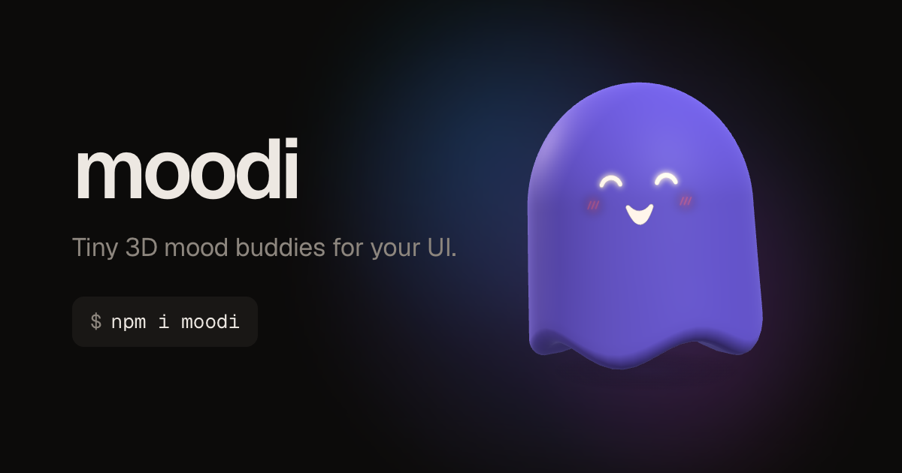

# moodi

**Tiny 3D mood buddies for your UI** — a soft 3D character you drop into any
website with one line. Its face shows what is happening: thinking, loading,
happy, error, sleeping.



- **Playground:** <https://moodi-site.vercel.app>
- **Package docs:** [packages/moodi/README.md](packages/moodi/README.md)
- by [@itsk0rn3l](https://x.com/itsk0rn3l)

```bash
npm i moodi three
```

```tsx
import { Moodi } from 'moodi/react';

<Moodi mood={isLoading ? 'loading' : 'idle'} />
```

```html
<script type="module" src="https://esm.sh/moodi"></script>
<moodi-buddy mood="happy"></moodi-buddy>
```

## Repository

```
packages/moodi   the library (TypeScript, tsup, three.js peer dependency)
apps/site        demo / landing site (Next.js 16, Tailwind CSS 4, deployed on Vercel)
```

## Development

Requires Node 20+ and pnpm 8+.

```bash
pnpm install
pnpm dev         # builds the package, starts the site on http://localhost:3000
pnpm build       # package + site production build
pnpm typecheck
```

`/lab` on the dev site renders every shape × mood combination.

## Releasing the package

```bash
cd packages/moodi
npm version patch        # or minor / major
git push --follow-tags   # the Release workflow publishes tags v* to npm
```

The workflow needs an `NPM_TOKEN` repository secret (npm granular token with
publish rights for `moodi`), or npm Trusted Publishing configured for this repo.
First publish can be done by hand: `npm run build && npm publish --access public`.

## Deploying the site

The site deploys to Vercel from this repository (root directory `apps/site`).
Pushes to `main` go to production, pull requests get preview URLs.

## Contributing & security

See [CONTRIBUTING.md](CONTRIBUTING.md) and [SECURITY.md](SECURITY.md).

## License

[MIT](LICENSE) © itsk0rn3l
